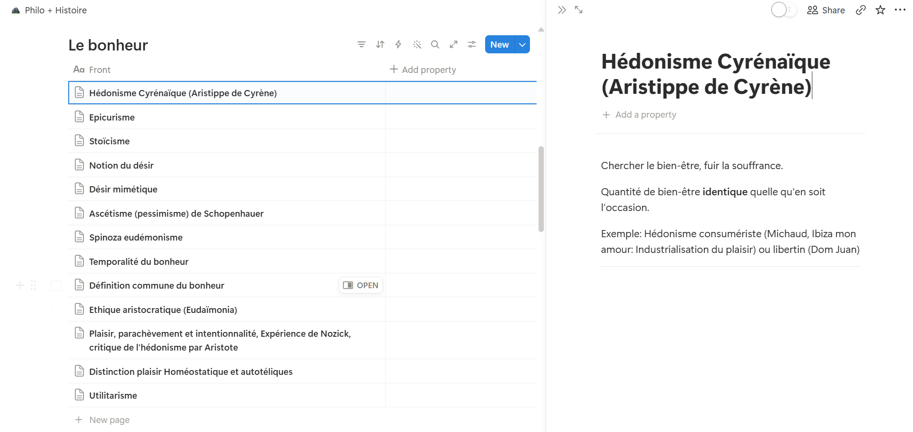

# Notion Table Exporter

Export content from Notion pages that use tables into clean, readable documents.

This tool is useful for Notion pages where the content you want to export is stored inside one or more tables. Select the tables you need, choose an export format, and download the result.


## Préparer la page Notion

La page Notion doit contenir une ou plusieurs bases de données intégrées. Chaque ligne de la base doit être une page (par exemple une leçon), afin que l’exporteur puisse récupérer son titre et son contenu. Une vue en tableau avec une colonne **Name**/titre suffit ; les autres propriétés sont facultatives.

Voici un exemple de structure compatible :



## What it supports

- Export one or multiple Notion tables together
- HTML, Word (`.docx`), and PDF-ready exports
- Code blocks and inline code
- LaTeX formulas
- Images
- Lists, headings, paragraphs, dividers, and other common Notion content

## Exporting a page

1. Open the exporter.
2. Paste the link to a Notion page containing your tables.
3. Select the tables to include.
4. Choose the text size when exporting HTML or PDF.
5. Click the format you want:
   - **HTML** — download an HTML document.
   - **Word** — download a `.docx` document.
   - **PDF** — open a print-ready document and choose **Save as PDF** in your browser.

The exporter uses the page link directly. Make sure the page is shared with the exporter before opening it.

## Connect your Notion account

1. Open [My integrations](https://www.notion.so/my-integrations) in Notion.
2. Click **New integration**, select your workspace, then create the internal integration.
3. On the integration page, copy the **Internal Integration Secret** (the token, usually beginning with `secret_` or `ntn_`).
4. In Notion, open the page to export, choose **Share**, and invite the integration so it can access the page and its databases.
5. Paste the token into the exporter, or store it as `NOTION_API_TOKEN` in a local `.env` file.

Never commit the token or share it publicly. The token is only needed when the page is private; public pages may work without it.

## PDF limitations

PDF export is experimental. Font ligatures may not render perfectly, and there may be other minor formatting quirks because the PDF is generated through the browser's print workflow.

## Embed a single table

To show one table directly in the export interface, use:

```text
/embed/<page_or_table_id>
```
