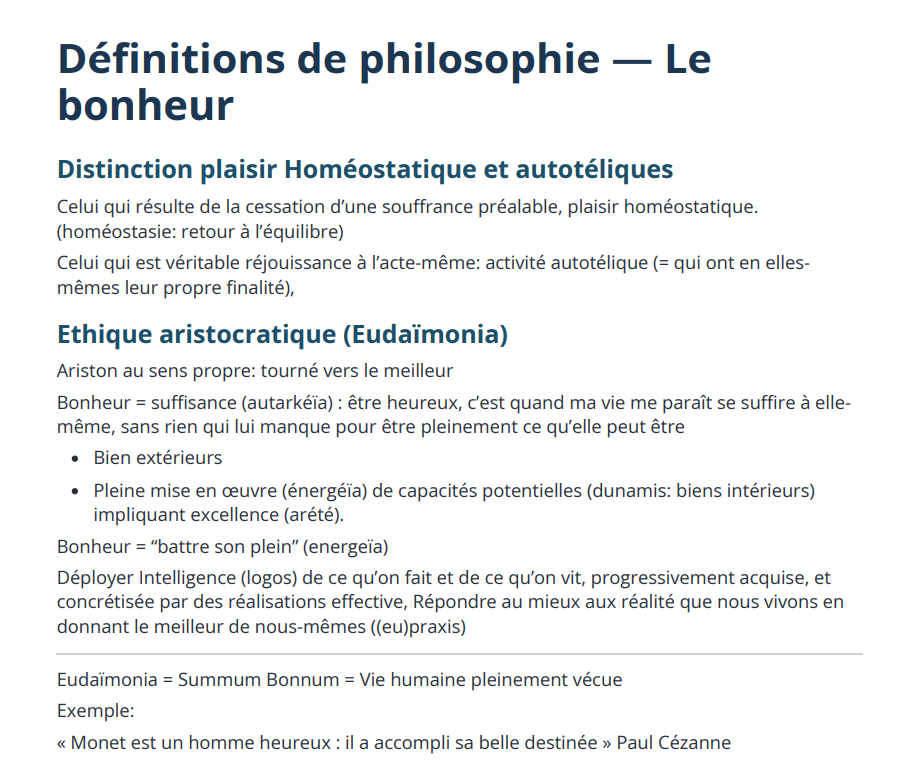

# Notion Table Exporter

Export content from Notion pages that use tables into clean, readable documents.

This tool is useful for Notion pages where the content you want to export is stored inside one or more tables. Select the tables you need, choose an export format, and download the result.



## What it supports

- Export one or multiple Notion tables together
- HTML, Word (`.docx`), and PDF-ready exports
- Code blocks and inline code
- LaTeX formulas
- Images
- Lists, headings, paragraphs, dividers, and other common Notion content

## Getting started

### 1. Configure your Notion integration

Copy the example environment file:

```bash
cp .env.example .env.local
```

Add your Notion integration token to `.env.local`:

```env
NOTION_TOKEN=secret_your_token_here
```

Make sure your Notion integration has access to the page and the tables you want to export.

### 2. Install and start the app

```bash
bun install
bun run dev
```

Open [http://localhost:3000](http://localhost:3000), then paste a Notion page URL or page ID.

## Exporting a page

1. Paste the URL or ID of a Notion page containing your tables.
2. Select the tables to include.
3. Choose the text size when exporting HTML or PDF.
4. Click the format you want:
   - **HTML** — download an HTML document.
   - **Word** — download a `.docx` document.
   - **PDF** — open a print-ready document and choose **Save as PDF** in your browser.

For private pages, you can provide the integration token in the app URL as `?token=<your_token>`.

## Embed a single table

To show one table directly in the export interface, use:

```text
/embed/<page_or_table_id>?token=<your_token>
```
