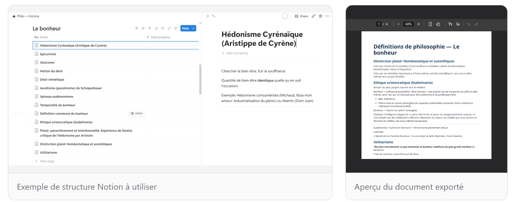
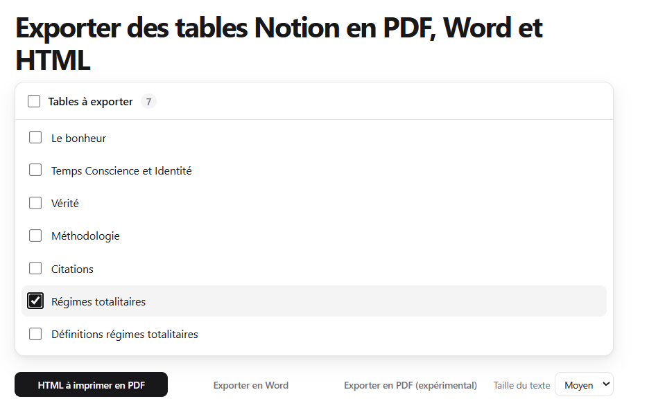

# Notion Table Exporter

Export the content of your Notion pages to PDF, Word, or HTML.

## 1. Compatible structure

The Notion page must contain an inline database, with one row per page to export.

## 2. Exported document

Page content is converted into a clean, readable document. Select the pages to export, then choose the desired format.

The following Notion elements are supported:

- MathJax and LaTeX formulas
- Code blocks and inline code
- Tables

## Notion token

1. Open [My integrations](https://www.notion.so/my-integrations).
2. Click **New integration**, choose your workspace, and create the internal integration.
3. Copy the **Internal Integration Secret**.
4. Paste the token into the application, or store it as `NOTION_API_TOKEN` in a `.env` file.

Never commit the token or share it publicly.
