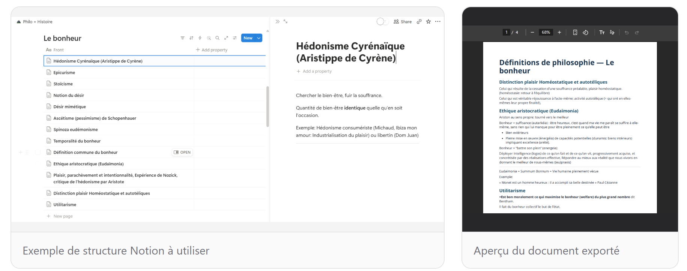
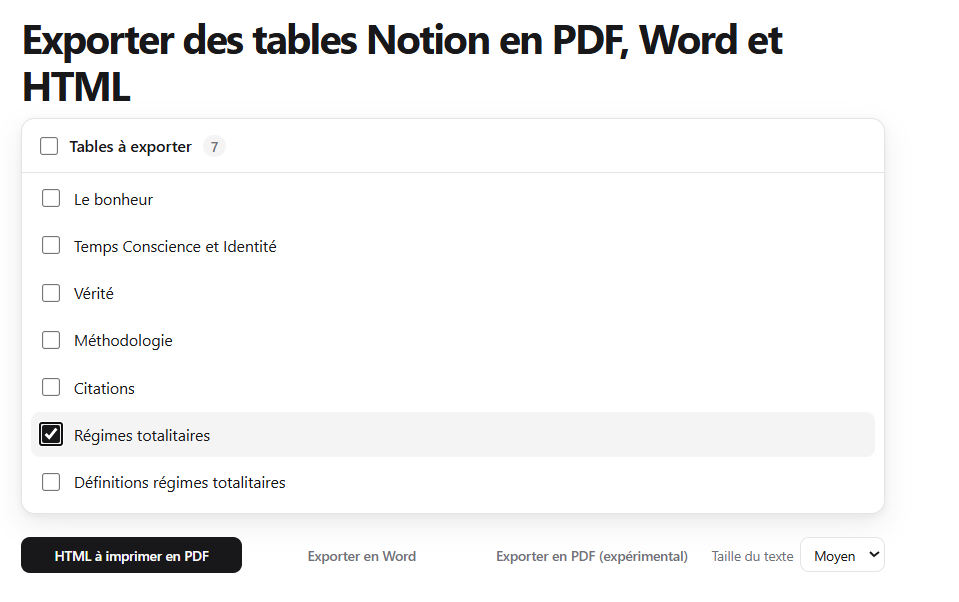

# Notion Table Exporter

Export the content of your Notion pages to PDF, Word, or HTML.

## 1. Compatible structure

The Notion page must contain an inline database, with one row per page to export.



## 2. Exported document

Page content is converted into a clean, readable document. Select the pages to export, then choose the desired format.



The following Notion elements are supported:

- MathJax and LaTeX formulas
- Code blocks and inline code
- Tables

## Embedding in Notion

Notion blocks downloads inside embeds, so embed the launcher page instead of the exporter:

```
https://<your-app>/embed?id=<page_id>
```

It shows a single "Ouvrir l’export" button that opens the full exporter for that page in a new tab. Use **Copier le lien embed** on the home page to get this link.

## Notion token

1. Open [My integrations](https://www.notion.so/my-integrations).
2. Click **New integration**, choose your workspace, and create the internal integration.
3. Copy the **Internal Integration Secret**.
4. Paste it under **Avancé** on the home page, or store it as `NOTION_API_TOKEN` in a `.env` file.

The token entered in the app is kept in an `HttpOnly` cookie for 30 days. Page scripts can't read it, and it never appears in links, browser history or server logs. Older links that still carry `?token=` keep working: the token is moved into the cookie and removed from the address bar.

The home page also lists recently exported pages. Only page IDs and names are stored, in the browser's local storage.

Never commit the token or share it publicly.
